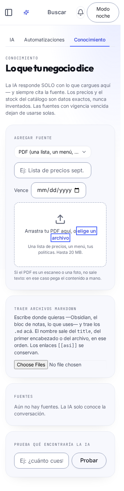
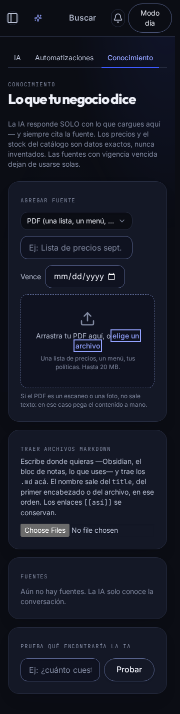
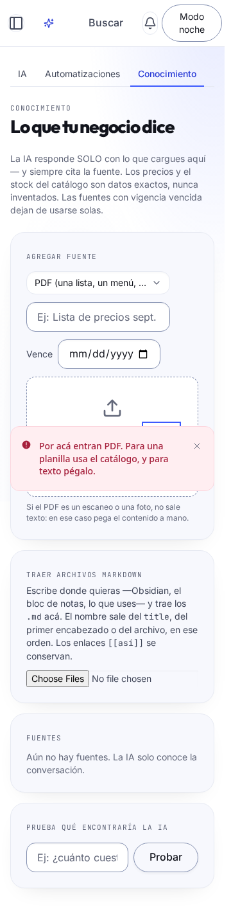
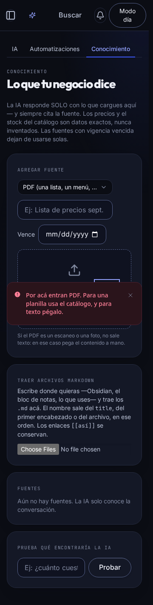

# #519 · Card y Label de Pulso

Se incorporan los dos primitivos que faltaban y se usan en el formulario existente de conocimiento: Card en «Agregar fuente» y Label en el selector nativo del PDF. La zona de arrastre conserva el radio campo de 14 px, los gestos y el flujo de subida/indexación.

## Origen y licencia

Fuente oficial verificada el 2026-10-16, commit `3f759d5171c2391253ec4c772e9e5b3db2bc7c7f` de [ephraimduncan/blocks](https://github.com/ephraimduncan/blocks/tree/3f759d5171c2391253ec4c772e9e5b3db2bc7c7f):

- [Card](https://github.com/ephraimduncan/blocks/blob/3f759d5171c2391253ec4c772e9e5b3db2bc7c7f/components/ui/card.tsx).
- [Label](https://github.com/ephraimduncan/blocks/blob/3f759d5171c2391253ec4c772e9e5b3db2bc7c7f/components/ui/label.tsx).
- [file-upload-04](https://github.com/ephraimduncan/blocks/blob/3f759d5171c2391253ec4c772e9e5b3db2bc7c7f/content/components/file-upload/file-upload-04.tsx), ya adaptado en #522 y compartido mediante `useArrastre` en #561.
- [Licencia MIT](https://github.com/ephraimduncan/blocks/blob/3f759d5171c2391253ec4c772e9e5b3db2bc7c7f/LICENSE.md), copyright © 2025 Ephraim Duncan, reproducida íntegra en [packages/ui/licenses/blocks.MIT.txt](../../../packages/ui/licenses/blocks.MIT.txt).

Cada primitivo documenta el origen y los cambios en su cabecera. Card usa radio tarjeta (22 px), superficie, borde y tipografía Pulso, con espaciado decidido por el contenido. Label mantiene semántica HTML, ref y asociación explícita o implícita; el foco del input visualmente oculto se dibuja sobre su etiqueta.

El upstream usa Tailwind 4.1.12; IAxTi usa 3.4. Se adaptan las clases a las utilidades existentes y se omiten las variantes de espaciado/contenedores v4. No se incorporan subcomponentes sin consumidor, sombras locales ni efectos nuevos. No se añaden dependencias.

## Verificación

Las pruebas DOM de `packages/ui` cubren ref, atributos HTML, eventos, asociación de etiquetas y selección por teclado. Las de `apps/web` montan `SubirPdf` con el Label real y verifican rechazo, reintento, progreso, indexación y finalización. El transporte de estas pruebas es simulado; no se valida R2 con credenciales externas.

## Resultados locales

- `pnpm antes-de-empujar --filter=@iaxti/ui --filter=@iaxti/web`: aprobado. UI 89, web 333, core 348 y DB 52 pruebas aprobadas (822 en total); 10 pruebas XLSX omitidas por su condición existente. Build, typecheck, dependency-cruiser, catálogo y las siete guardas finales aprobados; ninguna excepción ni lista base cambió. Migraciones: 97 sobre base nueva. ESLint: cero errores y cuatro advertencias preexistentes fuera del cambio.
- Las ocho pruebas DOM nuevas están incluidas en esas suites: cinco para primitivas y tres para el recorrido PDF.
- Chromium real contra build standalone y API local: dos casos aprobados, `/ajustes/conocimiento`, día/noche a 360×780. El selector se alcanza con Tab desde Vigencia y Enter abre el diálogo real de archivos; un archivo no PDF muestra el aviso existente y permite reintentar.
- Medición CSS: Card 22 px; zona de arrastre 14 px; Label Inter, 14 px; foco sólido de 2 px. Sin scroll horizontal ni errores de página. Colores y contraste medidos en los JSON adjuntos.
- Capturas inspeccionadas visualmente; se espera el final de la transición del aviso antes de capturar el estado de error. El primer intento del guion visual apuntó por error a `/conocimiento` (404); se corrigió únicamente el guion local para usar la ruta real.

La revisión visual usa datos sintéticos en una base aislada, Redis local y puertos 4013–4015. El arnés emplea su rol propietario habitual; estas capturas no constituyen prueba RLS. No se levantaron workers ni se enviaron archivos a un proveedor externo. Las pruebas de transporte de subida/indexación usan sustitutos explícitos.

## ui-check

Los archivos nuevos y las dos integraciones usan tokens y clases del preset Tailwind 3.4, sin colores locales, sombras, gradientes, emoji ni variantes de modo. Card conserva el contenedor semántico; Label conserva el input nativo y su asociación. No se añaden botones, mutaciones, consultas ni cambios de estado asíncrono. Las pruebas del recorrido cubren vacío, error/reintento, subida, progreso, indexación y éxito; las pruebas del hook de arrastre existente también siguen aprobadas.

## Capturas

| Día, selector con foco | Noche, selector con foco |
| --- | --- |
|  |  |

| Error en día | Error en noche |
| --- | --- |
|  |  |
