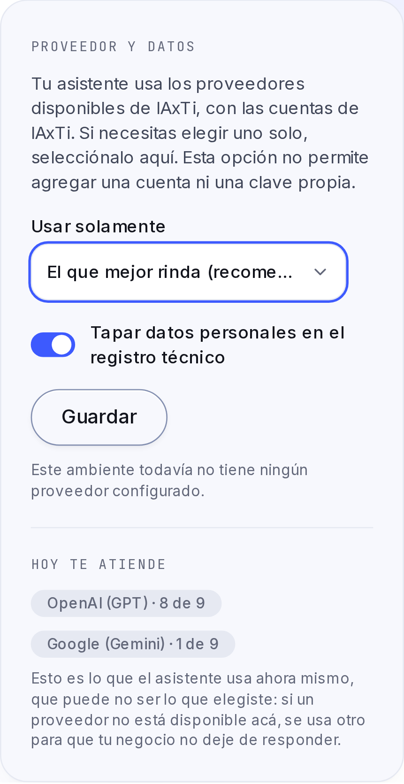
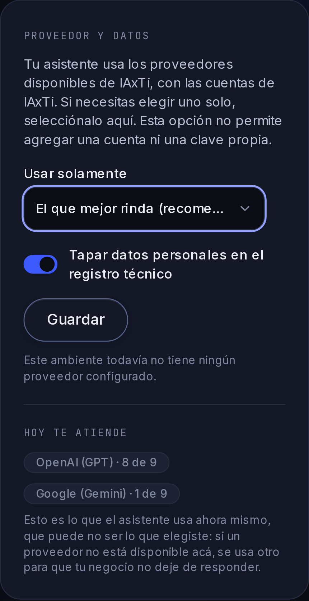

# Aclaración del selector de IA · #856

La issue [#856](https://github.com/voxtilabs/IAxTi/issues/856) pide expresamente una aclaración pequeña mientras se decide BYOK. El selector indica ahora que usa proveedores y cuentas de IAxTi y que no permite agregar una cuenta ni una clave propia. Al medir esta pantalla, el selector tenía 36 px de alto; usa ahora el token `h-control` de 46 px.

Solo cambian ese texto y la altura del control. No se agregan llaves por tenant, medidores, cambios de proveedor, cargos, fallback ni decisiones de compliance. La issue completa queda abierta; este PR no decide sus preguntas pendientes.

## Verificación

- `TODO=1 pnpm antes-de-empujar`: aprobado; detalle de conteos y huella del log en [verificacion.json](verificacion.json).
- Después de corregir la altura medida: build web aprobado y dos comprobaciones visuales aprobadas con Chromium, API real, usuario sintético ADMIN y rol PostgreSQL sin superusuario ni BYPASSRLS.
- Día/noche, 360 px: texto visible, selector 46 px, foco 2 px, sin desbordamiento horizontal ni errores de navegador.
- `/ui-check`: tokens de Pulso existentes; sin hex, modos condicionales, efectos o nuevos controles. Capturas inspeccionadas visualmente.
- Crítica independiente del texto: agente `implement_902`, distinto del autor. Sin hallazgos bloqueantes; cotejó body completo, comentarios vacíos y lectura efectiva de credenciales del despliegue.

Las capturas muestran un entorno de prueba sin proveedores habilitados. No acreditan inferencias reales ni una conexión BYOK.

